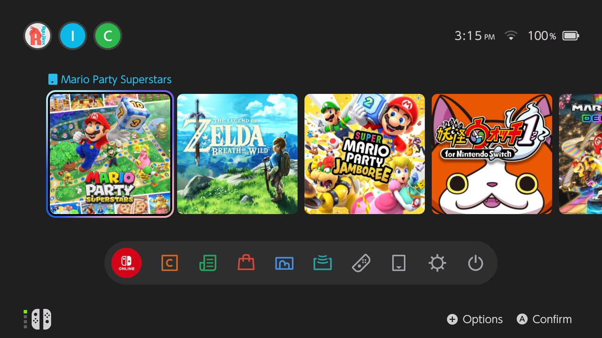
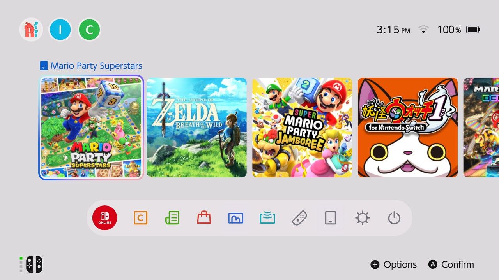
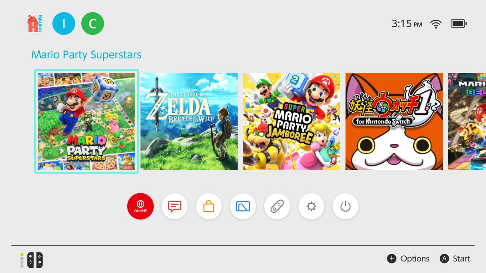
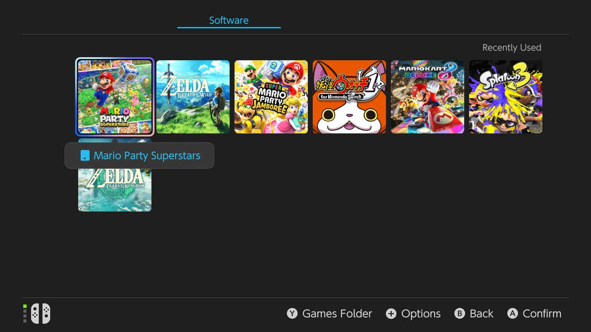
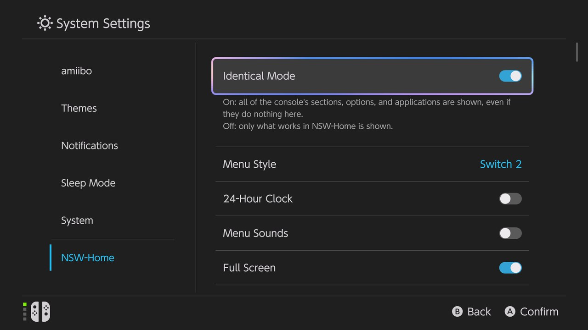
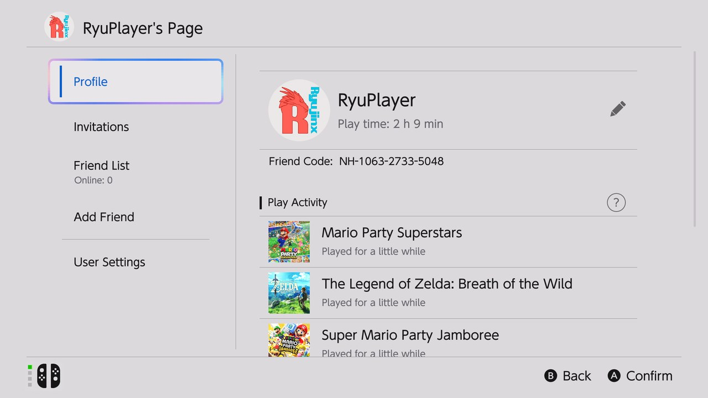
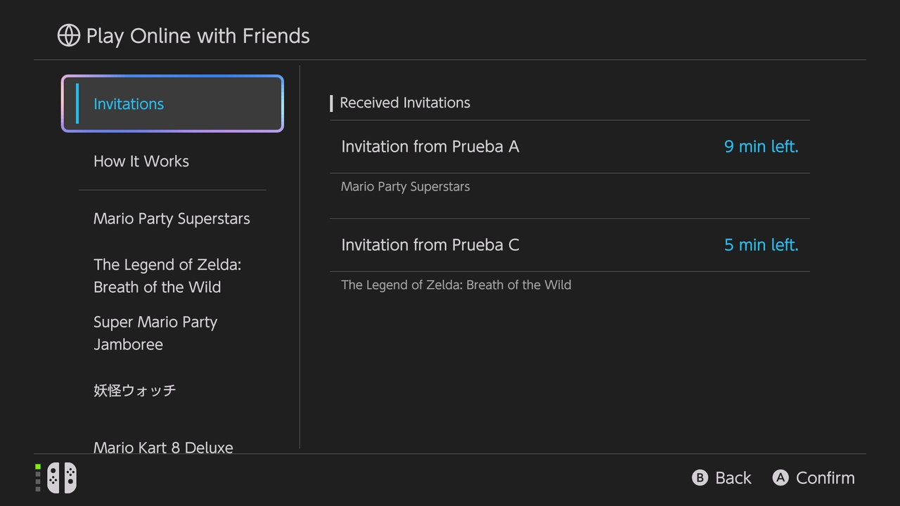

# NSW-Home

A console-style home menu for playing **your own** Switch game dumps on a PC, with the emulator kept
completely out of sight. NSW-Home starts the game in the emulator of your choice, shows its picture
inside its own window, and handles everything around the game itself: users, settings, controllers,
screenshots, friends, updates and add-ons. The emulator only emulates.



| | |
|---|---|
|  |  |
|  |  |
|  |  |

*Screenshots show games dumped by the author from his own console; their names and artwork belong
to their publishers and are read by NSW-Home from the user's own dumps. None of them are included
in this repository.*

It is a native C++17 program (Win32 + Direct2D on Windows; SDL2 + Cairo on Linux, macOS and
Android). No Electron, no web runtime, one executable.

> **NSW-Home is an independent project. It is not affiliated with, endorsed by or sponsored by
> Nintendo.** "Nintendo", "Nintendo Switch", "Switch" and "Nintendo eShop" are trademarks of their
> owners and are used here only to describe what the program works with. NSW-Home contains no
> Nintendo software, firmware, keys, games, artwork, fonts or sounds, and it does not tell you where
> to get any of them.

## What you need

- A PC running Windows 10/11 (Linux, macOS and Android builds also exist, see below).
- One of the supported emulators, installed by you.
- **Your own** dumps of games you own, and **your own** console keys and firmware, dumped from
  your own console. NSW-Home reads them from where you keep them; it never downloads, ships or
  shares them.

Without your firmware, NSW-Home uses its own sounds and a system font. With it, the console's own
sounds, font and wording are read from your firmware at run time (nothing is copied).

## Supported emulators

| Family | Emulators | Notes |
|---|---|---|
| Ryujinx | Ryujinx 1.1.x, Ryubing, Kenji-NX | Online play with friends: Ryubing and Kenji-NX only |
| yuzu | Eden, Suyu, Citron | |

Native PC programs (for example recompiled games) can be added as games too; no emulator is
needed for them.

## Features

- Home menu, game row, all-software grid, album, user pages and settings in the style of the
  console's first or second generation, light and dark, with animations measured frame by frame.
- The emulator's window is never shown: the game is displayed inside NSW-Home, the emulator's
  dialogs are answered in NSW-Home's own dialogs, its hotkeys are blocked, and the game pauses when
  you go to HOME.
- Users mirrored into every emulator; separate saves per user.
- Controllers read by NSW-Home itself (DualSense, DualShock 4, Switch Pro, Joy-Con, XInput) with
  player order passed to the emulator.
- Screenshots taken by NSW-Home, an album, and a capture key.
- Friends without a server, by request and acceptance, over the public BitTorrent DHT; online play
  with friends for games with a local wireless mode (Ryubing / Kenji-NX).
- Game updates, DLC, mods and cheats managed per game; amiibo collection from your own dumps.
- Settings rows given real meanings on a PC (display, sound, network, accessibility, parental
  controls, data management...).
- 16 languages; English by default.
- An "identical" mode that shows every row of the console's menus, and a normal mode that shows
  only what works on a PC.

## Building

**Windows** (Visual Studio 2022 or its Build Tools, C++ workload):

```
build.bat            → build\NSW-Home.exe
build.bat dev        → build\dev.exe (test build)
```

**Linux / macOS** (CMake, pkg-config, SDL2, Cairo, FreeType, fontconfig, libjpeg):

```
cmake -S . -B build-linux && cmake --build build-linux -j
```

**Android**: see `android/` (`fetch_deps.sh` downloads the third-party sources, then Gradle).

## Data

Settings, users, captures and caches live in `%APPDATA%\NSW-Home` (Windows) or
`~/.config/NSW-Home` (Linux). Nothing is written to the emulators' folders except the settings
NSW-Home manages for you, always with a backup of the original file.

## Privacy

NSW-Home sends nothing over the network until you turn something on: friends (after a consent
screen that explains what is shared), online play, the update check (only when you press it), and
the web pages of the shop and news buttons.

## License

GNU General Public License v3.0 — see [LICENSE](LICENSE). Third-party code and its licenses are
listed in [THIRD_PARTY.md](THIRD_PARTY.md).
